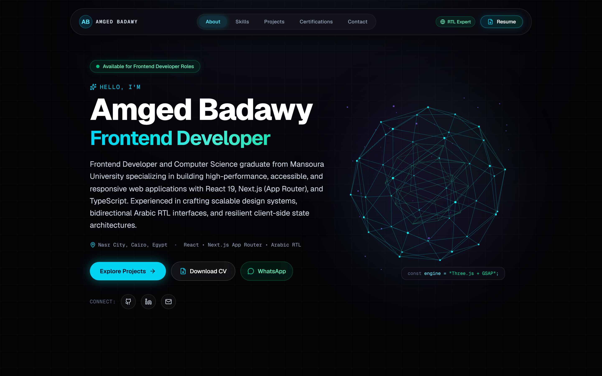

<div align="center">

# Amged Badawy — Modern Interactive Portfolio
### **Frontend Developer & UI Architect**

[](https://amged-badawy.vercel.app)
[](https://github.com/AmgadBadawy)
[](https://www.linkedin.com/in/amged-badawy-7a48b1177/)

<br />

[](https://nextjs.org/)
[](https://react.dev/)
[](https://www.typescriptlang.org/)
[](https://tailwindcss.com/)
[](https://gsap.com/)
[](https://threejs.org/)
[](https://playwright.dev/)

<br />

<p align="center">
  
</p>

</div>

---

## 🚀 Overview

A high-performance personal portfolio engineered for **Amged Badawy** (Frontend Developer and Computer Science graduate from Mansoura University). Built from the ground up to showcase production-grade frontend architecture, bespoke **React Bits** interactive primitives, procedural **Three.js** 3D graphics, smooth **GSAP** timelines, and specialized **Arabic Right-to-Left (RTL)** engineering.

### 🔗 Live Production URL
* **Live Site:** [https://amged-badawy.vercel.app](https://amged-badawy.vercel.app)
* **GitHub Repository:** [https://github.com/AmgadBadawy/Advanced-portfolio](https://github.com/AmgadBadawy/Advanced-portfolio)
* **Download Curriculum Vitae:** [Amged Badawy CV (PDF)](public/AmgedBadawy-CV.pdf)

---

## 💎 Architectural Highlights & Design System

### 1. Hybrid Server-Client Boundary Isolation
* **100% Static Root Rendering:** `page.tsx` and `layout.tsx` remain pure React Server Components for instantaneous first contentful paint (FCP), minimal hydration overhead, and optimal Core Web Vitals.
* **Isomorphic Interactive Nodes:** All animations, physics, and canvas lifecycles are isolated in `src/components/ui/` with strictly guarded `'use client'` leaves.

### 2. Custom React Bits & 3D Interactive Primitives
* **`SpotlightGrid`**: Cursor-tracking radial spotlight interacting with an obsidian grid matrix and ambient breathing glow fields.
* **`DecryptedText`**: High-tech character scrambling/decoding algorithm that decrypts developer roles when scrolled into view.
* **`TiltCard3D`**: Multi-axis perspective tilt with dynamic specular sheen reflecting cursor angle on project showcases.
* **`MagneticButton`**: Spring physics magnetic pull effect applied to primary action CTAs and social channels.
* **`TechMarquee`**: Smooth infinite horizontal skill ticker with hover-pause and gradient edge alpha masks.
* **`InteractiveCanvas3D`**: Procedural dual-layer crystalline polyhedron rendered in Three.js with glowing vertex nodes and real-time mouse parallax.

### 3. Arabic RTL-First Specialization
* Proven expertise in bidirectional layouts, CSS logical properties, and typography hierarchy for Arabic-first digital products — demonstrated in the **Masar** governmental citizen guide.

### 4. Zero Placeholder Data
* Built on verified real-world projects, live production deployments, institutional certifications (Manara, Mansoura University CCIC, COURSSAT UK), and Computer Science degree credentials.

---

## 📁 Clean Codebase Hierarchy

```text
advanced-portfolio/
├── public/
│   ├── certificates/            # Verified credentials (Manara, CCIC, English tracks)
│   ├── projects/                # High-res mockups (Masar, FlowDesk, Budgetly)
│   ├── AmgedBadawy-CV.pdf       # ATS-friendly, clean clickable resume
│   └── portfolio-preview.png    # Live interface capture
├── src/
│   ├── app/
│   │   ├── globals.css          # Design tokens, obsidian dark theme, keyframe styles
│   │   ├── icon.tsx             # Dynamic edge favicon generator (ImageResponse)
│   │   ├── layout.tsx           # SEO metadata, OpenGraph, Twitter card tags
│   │   ├── opengraph-image.tsx  # Dynamic 1200x630 social share preview card
│   │   └── page.tsx             # Root Server Component assembling all sections
│   ├── components/
│   │   ├── layout/              # Navbar and Footer components
│   │   ├── sections/            # Hero, About, Skills, Projects, Certifications, Contact
│   │   └── ui/                  # React Bits primitives (Spotlight, DecryptedText, TiltCard, 3D Canvas)
│   └── data/
│       └── portfolio.ts         # Centralized developer information & project data
├── playwright.config.ts         # End-to-end testing configuration
├── tsconfig.json                # Strict TypeScript configuration
└── package.json
```

---

## 🛠️ Local Development & Build

### Prerequisites
* **Node.js**: v18.18+ or v20+
* **Package Manager**: `npm` (or `pnpm`)

### Setup Instructions

```bash
# 1. Clone repository
git clone https://github.com/AmgadBadawy/Advanced-portfolio.git
cd Advanced-portfolio

# 2. Install dependencies
npm install

# 3. Start local development server (Turbopack)
npm run dev
```

Visit [http://localhost:3000](http://localhost:3000) to view the live local instance.

### Production Build & Verification

```bash
# Build optimized static output
npm run build

# Start production server locally
npm run start
```

---

## 📬 Contact & Connect

* **Developer:** Amged Badawy
* **Role:** Frontend Developer
* **Email:** [amgedbadawy04@gmail.com](mailto:amgedbadawy04@gmail.com)
* **Phone / WhatsApp:** [+20 114 464 9776](https://wa.me/201144649776)
* **Location:** Nasr City, Cairo, Egypt
* **LinkedIn:** [linkedin.com/in/amged-badawy-7a48b1177](https://www.linkedin.com/in/amged-badawy-7a48b1177/)
* **GitHub:** [github.com/AmgadBadawy](https://github.com/AmgadBadawy)
